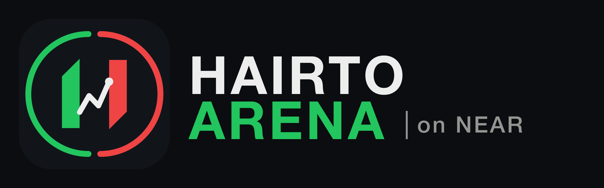
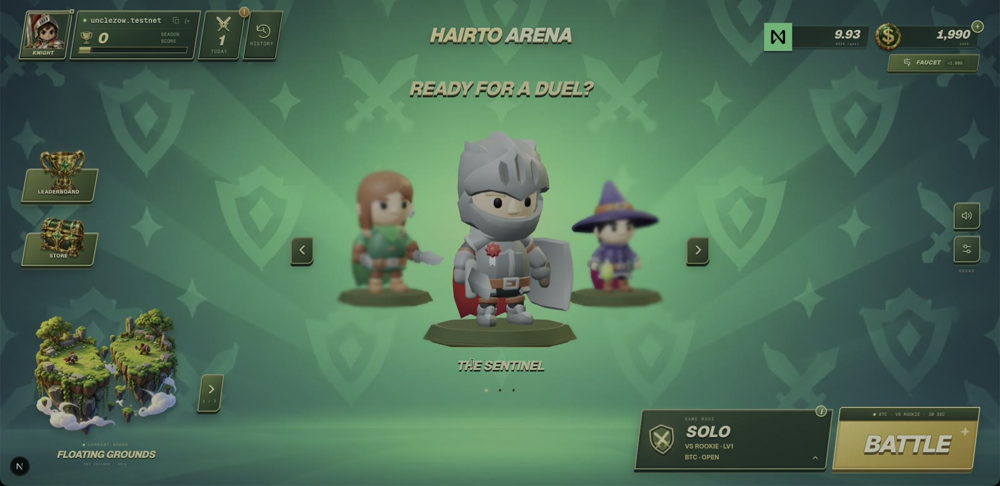
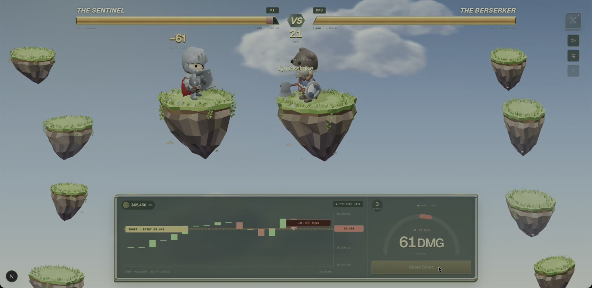
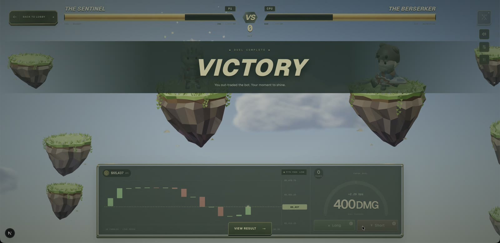
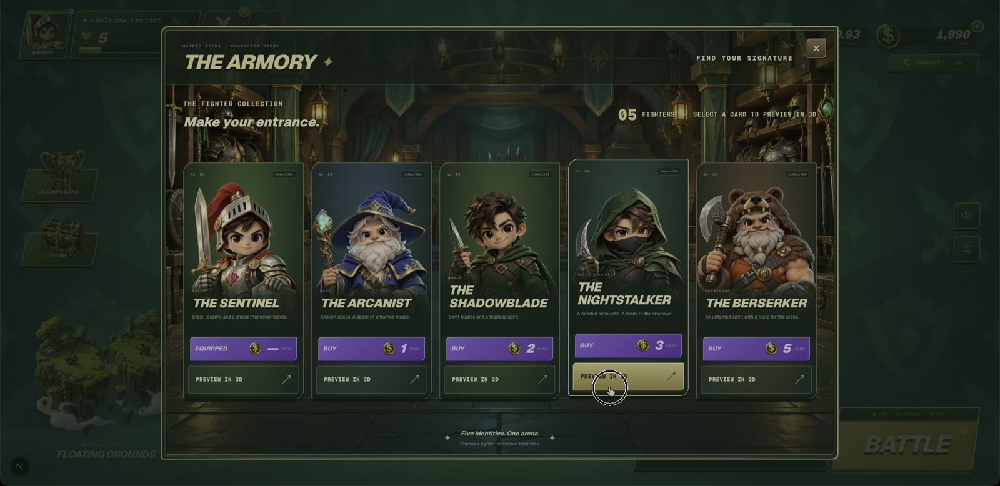
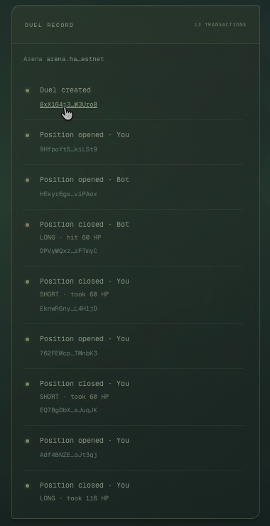
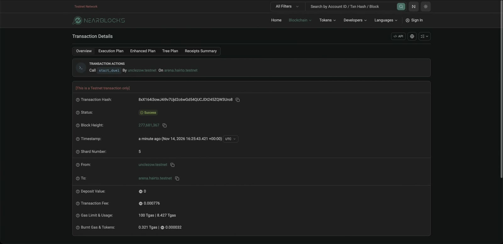
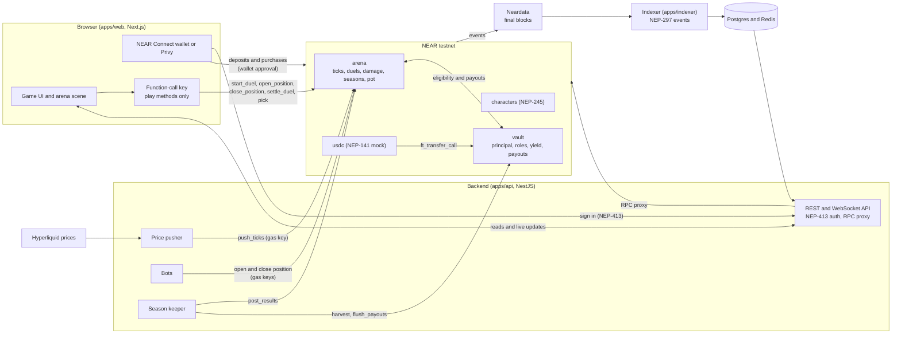
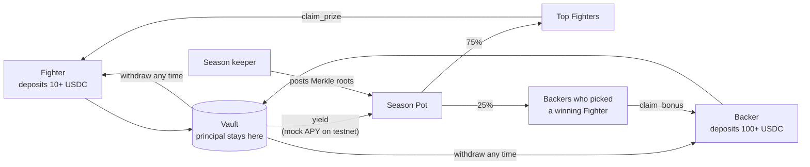
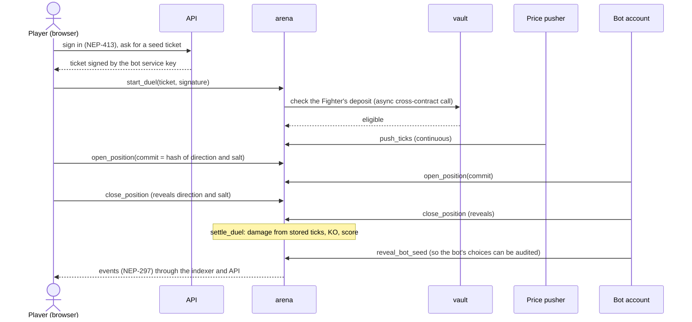

<p align="center">
  
</p>

# Hairto Arena (NEAR)

**Yield-funded paper-trading duels on NEAR. Your deposit stays safe, the yield becomes the prize.**

Built for NEAR HACKATHON 2026. Track: **Games With Real Economies** (`games`).

- Live demo: https://hairtoarena.xyz (NEAR testnet)
- Repository: https://github.com/unclezow/hairto-arena

> **Disclosure.** This is a port of Hairto Arena, a game first built on another chain. The three NEAR contracts (Rust, near-sdk), the chain clients, the wallet and sign-in flow, the price pusher, bots, season keeper and the NEP-297 indexer are new. Game rules, UI and the rest of the backend logic are reused from the original version, which is not part of this repository. See [Disclosure and baseline](#disclosure-and-baseline).

## What it is

Trading games force a choice: paper-only simulators where nothing is at stake, or real-money leverage where you can lose everything. Idle yield-bearing deposits do nothing in the meantime.

Hairto Arena connects the two:

- **Fighters** deposit at least 10 USDC and play 30-second duels against a bot. Positions are paper trades on a live price (BTC, GOOGL, XAU), so a Fighter cannot lose money by trading.
- **Backers** deposit at least 100 USDC and pick a Fighter they believe in.
- The vault keeps every deposit as principal and never uses it for prizes. Only the **yield** goes into the Season Pot: 75% to top Fighters, 25% to the Backers who picked right. Principal can be withdrawn.
- Each duel is settled by the arena contract. Positions are committed, then revealed, and damage is computed on-chain from price ticks the contract stores.

On testnet the USDC is a mock token and the yield is simulated (see [Real vs simulated](#real-vs-simulated)).

## Screenshots

Taken from a real run on NEAR testnet.

| | |
| --- | --- |
| <br/>**Lobby.** NEAR for gas, USDC balance, fighter selection. | <br/>**Duel.** 30 seconds, paper positions on a live price, damage shown as it lands. |
| <br/>**Victory.** The result is settled on-chain after the round. | <br/>**Armory.** Fighters are NEP-245 tokens bought with USDC. |

| Duel Record | Verified on NEARBlocks |
| --- | --- |
| <br/>Every duel lists its transactions (duel created, positions opened and closed, by the player and by the bot). | <br/>Each hash opens on the explorer: `start_duel` by the Fighter on `arena.hairto.testnet`, status Success. |

## Try it (about 5 minutes)

1. Get testnet NEAR for gas from https://near-faucet.io and open https://hairtoarena.xyz.
2. Click **Play**, connect a NEAR wallet (or use the Google/email option), and sign the login message. This is a NEP-413 signature and sends no transaction.
3. In onboarding, take mock USDC from the **Faucet** button, then choose a role.
4. **As a Fighter** (min 10 USDC): deposit, open the lobby, press **Battle**. During the 30 seconds, tap **Long** or **Short** and close the position. See the damage on the arena and the result page.
5. On the result page, the **Duel Record** lists every transaction of the duel. Open one on https://testnet.nearblocks.io to verify it.
6. **As a Backer** (min 100 USDC, a separate account, one role per account): deposit, then pick a Fighter on the Backer page. Wait for a season to close and use **Claim**.
7. Also in the app: Leaderboard, and the Store/Armory where fighters (NEP-245 tokens) are bought with USDC.

Contract calls, wallet approvals and explorer links are visible at each step. The wallet approval screens are real testnet transactions.

## How NEAR is used

| Feature | What it does | Where |
| --- | --- | --- |
| Three Rust contracts (near-sdk 5.30) | `arena` (price ticks, duels, damage, score, seasons, picks, pot, claims), `vault` (principal, roles, yield, payouts), `characters` | `contracts/arena`, `contracts/vault`, `contracts/characters` |
| NEP-141 + `ft_transfer_call` | Deposits go to the vault in one transfer-and-call. `usdc.hairto.testnet` is our own mock token | `contracts/mock-usdc`, `contracts/vault` |
| NEP-245 | Fighter characters are multi-tokens bought with USDC. The core is written in-house | `contracts/characters` |
| Function-call access key | Playing needs no wallet popup. The key can only call `start_duel`, `open_position`, `close_position`, `settle_duel` and `pick` on the arena, and cannot move funds | `apps/web/src/lib/near/quick-play-key.ts` |
| NEP-413 sign-in | Wallet login to the API with a signed message | `apps/web/src/lib/wallet-auth.ts`, `apps/api/src/auth` |
| Gas keys (NEP-611) | The price pusher and the bots send transactions through gas keys limited to specific methods | `deployments/testnet.json`, `apps/api/src/price`, `apps/api/src/bot` |
| Named accounts for NPCs | Each bot level has its own NEAR account and trades on-chain like a player | `rookie`, `trend`, `reversion` under `bots.hairto.testnet` |
| NEAR Connect + social login | Wallet selector (`@hot-labs/near-connect`) with Privy for Google/email | `apps/web/src/hooks/use-wallet-session.ts` |
| NEP-297 indexer | Reads final blocks from Neardata and writes contract events to Postgres | `apps/indexer` |

## Architecture

Three Rust contracts hold all game and money state. Everything else either sends transactions to them, reads their events, or serves the UI.



**Money flow.** Principal never funds prizes. Only the yield does.



**One duel, step by step.** Positions stay hidden until they are revealed, and the contract computes the damage itself from the ticks it stored.



## Real vs simulated

| Part | Status in the demo |
| --- | --- |
| Duels, commit-reveal, damage, KO, score | **Real**, on NEAR testnet |
| Bot NPC accounts and their transactions | **Real**, on-chain. Decisions come from configured rule-based strategies (levels 1 to 3) |
| Season Pot split and Merkle claims | **Real**, on-chain |
| Vault logic (principal, roles, minimums, fees, payouts) | **Real**, on-chain |
| Prices | **Real** feed, pushed on-chain by a service. Hyperliquid by default, Pyth Hermes is also supported |
| USDC | **Mock**: our own NEP-141, no value, free from the faucet |
| Yield | **Simulated**: a mock APY minted by the vault, labeled as such in the app |
| Trading positions | **Simulated** (paper) |
| Opponent | **Bot**, not another player |
| NEAR balance | **Testnet** NEAR, only for gas |
| Sponsors | None in this version |

## Not in this version

- **NEAR Intents** (fund or cash out from another chain). Planned for mainnet; there is no testnet for it, and no code for it in this repository.
- **NEAR AI Cloud oracle bot (level 4).** The slot is reserved in the arena contract and configuration, but the bot has no gas key and is not running.
- **Meta-transaction relayer (NEP-366).** Only a shared type exists, no relayer runs.
- **Human-vs-human duels, Elo and matchmaking.** The opponent is always a bot.
- **Mainnet deployment.**

## Deployed on NEAR testnet

All from [`deployments/testnet.json`](deployments/testnet.json).

| Role | Account |
| --- | --- |
| Arena | `arena.hairto.testnet` |
| Vault | `vault.hairto.testnet` |
| USDC (mock) | `usdc.hairto.testnet` |
| Characters (NEP-245) | `characters.hairto.testnet` |
| Owner and treasury | `hairto.testnet` |
| Operator, price pusher, season keeper | `ops`, `pusher`, `keeper` under `hairto.testnet` |
| Bots | `rookie`, `trend`, `reversion` under `bots.hairto.testnet` (`oracle` is reserved, inactive) |

Explorer: https://testnet.nearblocks.io/address/arena.hairto.testnet

## Repository layout

```
contracts/   Rust workspace: arena, vault, characters, mock-usdc, plus test mocks
apps/web     Next.js app: lobby, arena scene (three.js), trading panel, backer, claim, leaderboard, store
apps/api     NestJS API and workers: auth, RPC proxy, price pusher, bots, season keeper, realtime
apps/indexer NEP-297 indexer over Neardata into Postgres
packages/    shared types and parameters, config
deployments/ contract and service accounts per network
```

## Run it locally

Requirements: Node 22 or newer (`.nvmrc` pins 24), pnpm 11, Docker (Postgres and Redis). For contracts: Rust 1.96.1 (`contracts/rust-toolchain.toml`) and `cargo-near`.

```sh
pnpm install
pnpm db:up                                   # Postgres on :5434, Redis on :6379
cp apps/api/.env.example apps/api/.env
cp apps/indexer/.env.example apps/indexer/.env
pnpm db:generate && pnpm db:migrate          # Prisma client and schema
pnpm dev                                     # web on :3000, API on :3001
```

Create `apps/web/.env.local` if you need non-default values: `NEXT_PUBLIC_API_URL`, `NEXT_PUBLIC_WS_URL`, `NEXT_PUBLIC_NEAR_NETWORK` (default `testnet`), and optionally `NEXT_PUBLIC_PRIVY_APP_ID` and `NEXT_PUBLIC_PRIVY_CLIENT_ID` for Google/email login. Without Privy, only NEAR Connect wallets are offered.

Live gameplay needs the service keys (price pusher, bots, keeper). They are secrets and are not in this repository, so a local stack can run the web app, API reads and the test suites, but cannot push prices or run bots on the deployed contracts. To play end to end, use https://hairtoarena.xyz.

Tests and checks:

```sh
pnpm contracts:test      # cargo test for all contracts
pnpm test                # web, API and indexer unit tests
pnpm typecheck && pnpm lint
```

## Security notes

- No secrets are committed. Keys come from environment variables (`apps/api/.env.example` lists them, all empty).
- The contract owner is `hairto.testnet` and the deployer key is still held, because this is a testnet deployment. The mainnet plan is to move ownership to a Sputnik DAO and delete the full-access key.
- Service accounts use limited keys: the pusher and bots use gas keys restricted to specific methods, the keeper uses function-call keys.
- The browser never sees the RPC provider key: the API proxies RPC calls.

## Disclosure and baseline

- **Port.** Hairto Arena originally existed on another chain. This repository is a full NEAR port in a new repository, with the original version kept separate and not included here (hackathon rule Q-002).
- **Built for NEAR in this repository during the hackathon:** the Rust contracts and their tests, NEP-141/NEP-245 flows, function-call key play, NEP-413 sign-in, gas-key services, price pusher, bots as NEAR accounts, season keeper, RPC proxy, NEP-297 indexer, wallet integration and deployment setup.
- **Reused from the original version:** game rules and damage model, the web UI and its assets and animations, and parts of the API logic. Only hooks, data sources and labels were changed for NEAR.
- **AI-assisted code (Q-005):** a large part of the code was written with AI assistance (Claude Code) and reviewed by the team.
- **Main libraries and frameworks:** near-sdk and near-contract-standards, Next.js, React, NestJS, Prisma, three.js with react-three-fiber, near-kit, `@hot-labs/near-connect`, `@peerfolio/privy-near-connect`, Socket.IO, TanStack Query, Zustand, lightweight-charts, Radix UI, Turborepo.
- **Assets:** fighters and animations by KayKit (CC0), sound effects from Kenney (CC0), "Heartfelt Battle" music (CC0). Licenses sit beside the files and are listed in `apps/web/public/arena/CREDITS.md`. The floating-island scene, logos and combat effects are original.

## License

MIT.
